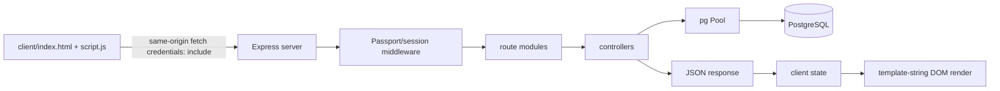
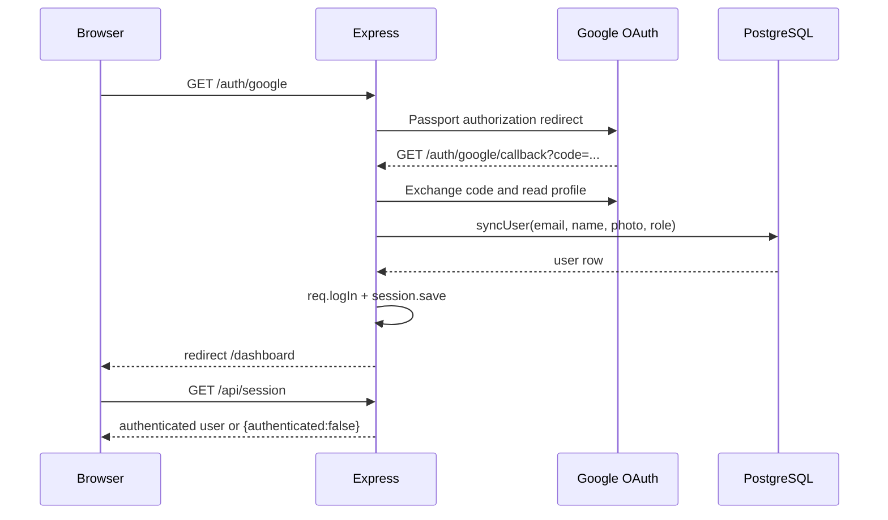
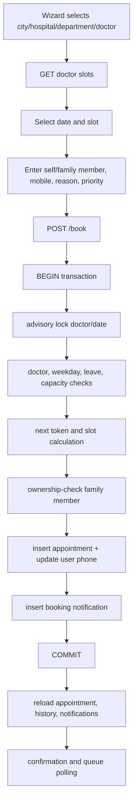

# Hospital Management System — Complete Codebase Audit, Actual Logic Documentation, and Product Transformation Blueprint

Audit date: 2026-10-22 (Asia/Kolkata)

Evidence labels used below:

- **Verified by static inspection** — supported directly by the current source/configuration.
- **Verified by test** — confirmed by an executed non-destructive check.
- **Partially verified** — the code path is visible, but runtime/database/external-service behavior was not executed.
- **Defect confirmed** — a concrete failure or unsafe behavior is supported by source inspection or a test.
- **Potential risk** — plausible concern requiring runtime or deployment confirmation.

## 1. Executive summary

This repository is a compact, same-origin hospital appointment and queue application called PulseCare HMS. It is a Node.js/Express server serving a hand-built browser client from `client/`, with PostgreSQL accessed directly through `pg`. Google OAuth establishes sessions; users are persisted in `users`, and role checks distinguish patients, doctors/staff, and administrators.

The strongest implemented capability is the patient booking flow: city → hospital → department → doctor → date/slot → patient/family member → review, followed by a transactional appointment insert, token assignment, notification creation, and confirmation view. The booking transaction uses a PostgreSQL advisory transaction lock per doctor/date, which is a meaningful concurrency safeguard.

The application also contains admin CRUD/dashboard operations, queue-board views, doctor availability/leaves, favorites, family members, profile editing, notifications, calendar/slip downloads, polling-based queue refresh, and optional SMTP reminders.

The repository is not production-ready yet. The most important verified concerns are:

1. Staff authorization is role-only: any authenticated doctor can request any doctor’s daily board, and any staff user can edit visit notes for any appointment (`server/routes/adminRoutes.js:42-44`, `server/middleware/auth.js:33-42`). There is no doctor-to-user identity mapping visible in the repository.
2. Admin delete endpoints permanently delete hospitals/doctors and their appointments inside transactions (`server/controllers/adminController.js:762-814`). This is an operational/data-retention risk even though the endpoints are admin-protected.
3. The schema is an in-process, startup mutation script rather than versioned migrations. It assumes baseline tables already exist and performs data updates on every startup (`server/config/schema.js:3-333`).
4. Existing appointments are backfilled with fixed 10:00/15-minute slot values (`server/config/schema.js:280-291`), which can disagree with doctor-specific schedules.
5. Dates, identifiers, phone numbers, scheduling intervals, and several admin inputs receive limited server-side validation. PostgreSQL type errors are often the first validation layer.
6. There are no repository tests, lint/type-check scripts, README, migration directory, or documented deployment manifest. Runtime behavior against PostgreSQL, Google, SMTP, and Render was not verified.

The current code should be stabilized in place. A rewrite or new framework would discard useful existing workflows and is not justified by this audit.

## 2. Repository and technology inventory

| Area | Actual implementation | Evidence/status |
|---|---|---|
| Frontend | Static HTML, CSS, and one large vanilla JavaScript file; DOM rendering with template strings | Verified by static inspection: `client/index.html`, `client/style.css`, `client/script.js` |
| Backend | Node.js with Express 4 | Verified: `package.json`, `server/server.js` |
| Database | PostgreSQL through `pg.Pool`; direct parameterized SQL | Verified: `server/config/db.js`, controllers |
| Authentication | Passport Google OAuth 2.0 plus `express-session` | Verified: `server/auth.js`, `server/routes/authRoutes.js` |
| Authorization | Middleware checks `patient`, `doctor`, and `admin` role/email | Verified: `server/middleware/auth.js` |
| Notifications | Database notifications for booking lifecycle; optional SMTP appointment reminders | Verified: `server/controllers/bookingController.js`, `server/services/*` |
| Charts | Chart.js loaded from jsDelivr and used by admin dashboard | Verified: `client/index.html`, `client/script.js` |
| Background work | In-process reminder scheduler using `setTimeout`/`setInterval` | Verified: `server/services/reminderService.js` |
| Package manager | npm; dependencies committed in `package-lock.json` | Verified |
| Tests | No test files or test script found | Verified by inventory |
| Build | No build step; server serves static assets | Verified |
| Start | `npm start` → `node server/server.js` | Verified: `package.json` |
| Deployment | Render-style environment support is implied by `RENDER_EXTERNAL_URL` and a hard-coded default deployment URL | Partially verified; no Render manifest or deployment documentation |
| Documentation | No `README.md` found | Verified |

The repository contains existing uncommitted changes. They were preserved and not reset. Current status at audit start included modifications to `.DS_Store`, `.gitignore`, `client/script.js`, `client/style.css`, `server/auth.js`, `server/middleware/auth.js`, `server/server.js`, `server/utils/slots.js`, plus untracked `.env.example` and `server/config/runtime.js`. Secret values in `.env` were not included in this report.

## 3. Repository map

```text
client/
  index.html              Static shell, login template, external assets
  script.js               Application state, routing, API calls, rendering, events
  style.css               Responsive/theme/layout styling
server/
  server.js               Express bootstrap, middleware, static serving, startup
  auth.js                 Google strategy and Passport serialization
  config/db.js            PostgreSQL pool
  config/schema.js        Startup schema/data/index maintenance
  config/runtime.js       Runtime URLs, roles, production configuration checks
  middleware/auth.js      Authentication and role middleware
  routes/                 Auth, patient, and admin route declarations
  controllers/            Request handlers and SQL business logic
  services/mailService.js SMTP transport and HTML reminder email
  services/reminderService.js In-process reminder scheduler
  utils/slots.js          Slot/time helpers and queue status constants
package.json              Runtime dependency and start command
package-lock.json         Locked npm dependency tree
.env.example              Required variable names, values redacted here
```

No generated build output, ORM models, migrations, upload directory, payment integration, SMS integration, or external API client was found. `node_modules/` was excluded from detailed inspection.

## 4. Actual architecture and execution flow

### Startup

1. `server/server.js` loads dotenv, Express, sessions, Passport, routes, schema maintenance, and reminder service.
2. It derives `BASE_URL`, `PORT`, cookie behavior, and production configuration through `server/config/runtime.js`.
3. It configures CORS for the configured base URL, JSON/urlencoded parsing, `express-session`, Passport initialization/session middleware, `/health`, static serving from `client/`, then route modules.
4. `startServer()` calls `ensureSchema()` before `app.listen()`. A schema failure prevents the server from starting. The reminder scheduler starts after listening.

### Frontend request lifecycle



`client/script.js:290-310` always sends `credentials: "include"`, sets JSON headers, converts non-2xx responses into client errors, and returns to the login screen after a 401 unless explicitly skipped. Event handlers are wrapped with `withSafeHandler` (`client/script.js:312-327`).

### Authentication lifecycle



`server/auth.js:6-41` creates/updates users. The configured admin email is forced to `admin`; other existing roles are preserved and new users default to `patient`. Passport serializes only the database user ID (`server/auth.js:63-82`).

### Appointment booking workflow



The booking logic is in `server/controllers/bookingController.js:43-216`. The client flow is in `client/script.js:2426-2890` and `3526-3573`.

### Queue behavior

Queue state is persisted in appointment status and token/priority fields. There is no WebSocket or server-sent-event implementation. Confirmation, admin board, and doctor board poll every 12 seconds (`client/script.js:514-546`). Emergency appointments sort before normal appointments; equal-priority items sort by token. “Now serving” is calculated as the first active appointment, not an independently persisted serving pointer.

## 5. Feature-by-feature audit

### Authentication and sessions

- UI: login template in `client/index.html:84-121`; client redirects to `/auth/google` at `client/script.js:559-562`.
- API: `/auth/google`, `/auth/google/callback`, `/api/session`, `/api/logout`.
- Storage: `users` table is assumed; session storage uses the default `express-session` MemoryStore.
- Cookie: `httpOnly`, `sameSite: "lax"`, `secure` only in production, seven-day max age (`server/server.js:39-52`).
- Assessment: **Implemented but not runtime-verified**.
- Risks: default session secret exists for development; production validation now rejects missing required variables, but the session store is not durable or horizontally scalable. OAuth callback behavior depends on exact `BASE_URL` and Google console configuration.

### Patient discovery and booking

- City/hospital/doctor discovery is backed by SQL joins in `dataController.js:15-160`.
- The client’s seven-step booking wizard is rendered by `script.js:644-1154` and persists a draft in `sessionStorage`.
- Server validation requires doctor, hospital, date, mobile, reason, and patient name (`bookingController.js:43-125`). Family-member ownership is checked against `req.user.id`.
- Capacity is enforced using `max_patients_per_day`; cancellation is excluded from active counts.
- Concurrency is addressed with `pg_advisory_xact_lock(hashtext(doctorId:date))`.
- Assessment: **Implemented with defects**. The current slot generator now honors doctor settings (`utils/slots.js:34-78`), but legacy appointment slot backfill still uses fixed global values (`schema.js:280-291`). Date format/range validation is incomplete.

### Availability and slot calculation

- Endpoint: `GET /doctor/:doctorId/slots`.
- `patientController.js:17-126` checks weekly unavailable days, doctor leave, active appointments, capacity, and generated slots.
- `bookingController.js:486-495` recalculates the selectable slot server-side, so client slot manipulation is not trusted.
- `utils/slots.js` supports start/end, interval, and duration with defaults.
- Assessment: **Partially verified**. Logic is statically traceable; no database-backed execution was performed.

### Cancellation, rescheduling, and check-in

- Cancellation is ownership-limited and disallows completed/cancelled appointments (`bookingController.js:219-262`).
- Rescheduling is ownership-limited, transactionally locks the new doctor/date, repeats availability/capacity checks, resets status to booked, and creates a notification (`bookingController.js:264-377`).
- Digital check-in only allows the appointment date and booked/pending status (`bookingController.js:379-421`).
- Assessment: **Implemented but not runtime-verified**. There is no explicit date validation and no transition audit history.

### Tokens, queues, and emergency priority

- Token values are generated from `MAX(token_number)+1` within a doctor/date transaction lock (`bookingController.js:541-559`).
- Priority is normalized to `normal` or `emergency`; SQL and JavaScript ordering use emergency-first logic.
- Queue position is computed in `dataController.js:506-581` using a CTE and active statuses from `utils/slots.js:5`.
- Admin and doctor boards use the same status/priority logic (`adminController.js:617-759`).
- Assessment: **Implemented but not runtime-verified**.
- Gaps: no database uniqueness constraint on `(doctor_id, appointment_date, token_number)` or slot number is visible; queue transitions are not audited; “now serving” is derived rather than persisted; polling can show stale state between intervals.

### Patient profile, family members, favorites, and notifications

- Profile reads and updates are in `dataController.js:278-346`; phone validation is permissive but present.
- Family member list/add is in `patientController.js:228-272`; there is no update/delete endpoint.
- Favorites use composite primary keys and toggle endpoints (`patientController.js:128-226`).
- Booking lifecycle notifications are created transactionally; read marking updates all unread notifications (`dataController.js:348-397`).
- Assessment: **Partially implemented**. Core read/add/toggle flows exist, but family-member management is incomplete and notification delivery is database/UI-only except for optional reminders.

### Admin dashboard and administration

- Dashboard counts/charts are real SQL aggregates (`adminController.js:94-145`).
- Admin can manage cities, hospitals, doctors, departments, leaves, appointment status, visit notes, queues, and CSV export.
- The client renders dashboard, tables, filters, forms, charts, board, and doctor-today views (`script.js:1924-2384`).
- Assessment: **Implemented but not runtime-verified**.
- Risks: delete operations permanently remove related appointments; visit-note and doctor-today staff access lacks resource ownership; appointment list has no pagination.

### Email reminders

- `mailService.js` creates an SMTP transporter only when SMTP variables are configured and HTML-escapes message values.
- `reminderService.js` scans today/tomorrow appointments and sends reminders within 120 minutes, then marks `reminder_sent_at`.
- Assessment: **Implemented but not runtime-verified**.
- Risks: in-process scheduler is lost on restart and can duplicate work across multiple instances; local time handling uses JavaScript `Date` without an explicit application timezone; marking happens after send without a claim/lock.

### Reports and exports

- Admin CSV export is implemented at `GET /admin/appointments/export` (`adminController.js:501-546`) and uses the same unpaginated filtered query as the admin table.
- No PDF, analytics warehouse, scheduled report, or audit export was found.
- Assessment: **Partially implemented**.

## 6. Complete API inventory

All routes below are mounted by `server/server.js`. Patient routes use `requireAuth`; admin routes use `requireAdmin`; two staff routes use `requireStaff`.

| Method/path | Purpose and implementation | Auth/ownership | Assessment |
|---|---|---|---|
| GET `/auth/google` | Start Google OAuth; `authRoutes.js:7-10` | Public | Partially verified |
| GET `/auth/google/callback` | OAuth callback, sync user, create session; `authRoutes.js:12-43` | OAuth provider | Partially verified |
| GET `/api/session` | Return current session user; `authController.js:1-10` | Public | Static verified |
| POST `/api/logout` | Passport logout, destroy session, clear cookie; `authController.js:12-40` | Session-aware | Static verified |
| GET `/cities` | Cities with hospital counts; `dataController.js:15-28` | Auth | Untested DB query |
| GET `/hospitals/:cityId` | Hospitals, favorites, doctor counts; `dataController.js:30-51` | Auth | Untested DB query |
| GET `/hospital/:hospitalId/details` | Hospital and doctors; `dataController.js:166-225` | Auth | Untested DB query |
| GET `/doctors/:hospitalId` | Doctors for hospital; `dataController.js:53-85` | Auth | Untested DB query |
| GET `/directory/doctors` | Filtered/search doctor directory; `dataController.js:87-164` | Auth | Untested DB query |
| GET `/doctor/:doctorId/details` | Doctor profile/stats; `dataController.js:227-276` | Auth | Untested DB query |
| GET `/doctor/:doctorId/slots` | Date availability and slots; `patientController.js:17-126` | Auth | Static logic verified; DB untested |
| POST `/book` | Transactional appointment creation; `bookingController.js:43-216` | Auth; family member owner check | Static logic verified; DB untested |
| GET `/profile` | User profile and appointment aggregates; `dataController.js:278-314` | Auth; self | Untested DB query |
| POST `/profile` | Update current user name/phone; `dataController.js:316-346` | Auth; self | Static validation verified |
| GET `/appointments/my` | Current user appointments; `dataController.js:454-505` | Auth; self query | Untested DB query |
| POST `/appointment/:appointmentId/cancel` | Cancel owned appointment; `bookingController.js:219-262` | Auth; owner | Static logic verified |
| POST `/appointment/:appointmentId/reschedule` | Reschedule owned appointment; `bookingController.js:264-377` | Auth; owner | Static logic verified |
| POST `/appointment/:appointmentId/check-in` | Same-day digital check-in; `bookingController.js:379-421` | Auth; owner | Static logic verified |
| GET `/queue/:doctorId/:date` | Queue position/current token; `dataController.js:506-581` | Auth; token query | Untested DB query |
| GET `/appointment/:appointmentId` | Owned appointment details; `dataController.js:399-452` | Auth; owner | Static ownership verified |
| GET `/notifications` | Up to 40 user notifications/unread count; `dataController.js:348-381` | Auth; user filter | Untested DB query |
| POST `/notifications/read` | Mark current user notifications read; `dataController.js:383-397` | Auth; user filter | Static ownership verified |
| GET `/favorites` | User’s favorite doctors/hospitals; `patientController.js:128-164` | Auth; user filter | Untested DB query |
| POST `/favorites/doctors/:doctorId` | Toggle doctor favorite; `patientController.js:166-195` | Auth; user key | Static logic verified |
| POST `/favorites/hospitals/:hospitalId` | Toggle hospital favorite; `patientController.js:197-226` | Auth; user key | Static logic verified |
| GET `/family-members` | List user family members; `patientController.js:228-242` | Auth; user filter | Untested DB query |
| POST `/family-members` | Add family member; `patientController.js:244-272` | Auth; user key | Static logic verified |
| GET `/admin/stats` | Counts and chart aggregates; `adminController.js:94-145` | Admin | Untested DB query |
| GET `/admin/cities` | Admin city list; `adminController.js:148-155` | Admin | Untested DB query |
| GET `/admin/departments` | Department list; `adminController.js:157-165` | Admin | Untested DB query |
| POST `/admin/add-city` | Create unique city; `adminController.js:168-194` | Admin | Static logic verified |
| GET `/admin/hospitals` | Hospital admin table; `adminController.js:197-213` | Admin | Untested DB query |
| POST `/admin/update-hospital/:id` | Update hospital; `adminController.js:243-278` | Admin | Static logic verified |
| GET `/admin/doctors` | Doctor admin table; `adminController.js:282-301` | Admin | Untested DB query |
| GET `/admin/appointments` | Filtered appointment list; `adminController.js:492-499` | Admin | Untested DB query |
| GET `/admin/appointments/export` | Filtered CSV; `adminController.js:501-546` | Admin | Static output logic verified |
| GET `/admin/doctor-leaves` | List leaves; `adminController.js:429-449` | Admin | Untested DB query |
| POST `/admin/doctor-leaves` | Upsert doctor leave; `adminController.js:451-471` | Admin | Static logic verified |
| POST `/admin/doctor-leaves/:id/delete` | Delete leave; `adminController.js:474-490` | Admin | Static logic verified |
| GET `/admin/board-data` | All-doctor current-day board; `adminController.js:617-689` | Admin | Untested DB query |
| GET `/doctor/:id/today-data` | One doctor’s current-day board; `adminController.js:691-760` | Any staff role | Defect confirmed authorization gap |
| POST `/admin/appointment/:id/status` | Change appointment status; `adminController.js:548-574` | Admin | Static logic verified |
| POST `/admin/appointment/:id/visit-notes` | Add/update visit notes; `adminController.js:576-615` | Any staff role | Defect confirmed authorization gap |
| POST `/admin/add-hospital` | Create hospital; `adminController.js:215-241` | Admin | Static validation only |
| POST `/admin/add-doctor` | Create doctor; `adminController.js:304-357` | Admin | Static validation only |
| POST `/admin/update-doctor/:id` | Update doctor; `adminController.js:359-427` | Admin | Static validation only |
| POST `/admin/delete-hospital/:id` | Delete hospital, doctors, appointments, leaves; `adminController.js:762-788` | Admin | High-risk destructive operation |
| POST `/admin/delete-doctor/:id` | Delete doctor, appointments, leaves; `adminController.js:790-814` | Admin | High-risk destructive operation |
| GET `/health` | Returns `{status:"ok"}`; `server/server.js:52-54` | Public | Static verified; does not check DB |

No duplicate route path was found. There is no pagination parameter on the main patient/admin list endpoints.

## 7. Database and data model audit

### Verified schema additions and constraints

`server/config/schema.js` assumes baseline `users`, `appointments`, `doctors`, `hospitals`, and `cities` tables already exist. It creates or alters:

- `users.phone`.
- `notifications`: `id`, `user_id`, nullable `appointment_id`, `type`, `title`, `message`, `read_at`, `created_at`; user and appointment foreign keys; allowed notification types.
- `departments`: `id`, unique `name`, `created_at`; seeds Cardiology, Ortho, Neuro.
- `doctors.department_id`, `max_patients_per_day`, `slot_step_minutes`, `slot_duration_minutes`; department foreign key and positive capacity check.
- `family_members`: user ownership, name, relation, timestamp.
- `favorite_doctors`: composite primary key `(user_id, doctor_id)` with cascading user/doctor deletes.
- `favorite_hospitals`: composite primary key `(user_id, hospital_id)` with cascading user/hospital deletes.
- `doctor_leaves`: doctor/date unique key, reason, timestamp.
- `appointments.slot_number`, `slot_start`, `slot_end`, `family_member_id`, `checked_in_at`, `reminder_sent_at`, `reason_for_visit`, `visit_notes`, `priority`; priority default/check; family-member foreign key.
- Indexes for doctor/date/slot, user/date, family members, doctor leaves, doctor department, doctor/date/priority/token, and notification access.

The baseline columns and constraints for the original tables are not defined in this repository. Their complete live schema is therefore **not verified**.

### Relationships

```mermaid
erDiagram
  USERS ||--o{ APPOINTMENTS : books
  USERS ||--o{ NOTIFICATIONS : receives
  USERS ||--o{ FAMILY_MEMBERS : owns
  USERS ||--o{ FAVORITE_DOCTORS : saves
  USERS ||--o{ FAVORITE_HOSPITALS : saves
  CITIES ||--o{ HOSPITALS : contains
  HOSPITALS ||--o{ DOCTORS : employs
  DEPARTMENTS ||--o{ DOCTORS : classifies
  DOCTORS ||--o{ APPOINTMENTS : attends
  DOCTORS ||--o{ DOCTOR_LEAVES : has
  HOSPITALS ||--o{ APPOINTMENTS : hosts
  FAMILY_MEMBERS ||--o{ APPOINTMENTS : may_be_booked_for
  APPOINTMENTS ||--o{ NOTIFICATIONS : references

  USERS { int id PK; text email; text role; text phone }
  CITIES { int id PK; text name }
  HOSPITALS { int id PK; int city_id FK; text name; text location }
  DOCTORS { int id PK; int hospital_id FK; int department_id FK; text name; time available_from; time available_to }
  APPOINTMENTS { int id PK; int user_id FK; int doctor_id FK; int hospital_id FK; date appointment_date; int token_number; text status; text priority }
  DEPARTMENTS { int id PK; text name }
  FAMILY_MEMBERS { int id PK; int user_id FK; text name; text relation }
  DOCTOR_LEAVES { int id PK; int doctor_id FK; date leave_date }
  NOTIFICATIONS { int id PK; int user_id FK; int appointment_id FK; text type; timestamp created_at }
```

The diagram includes relationships confirmed by SQL in this repository; original-table columns shown without local DDL are inferred only from query usage and are marked by the limitation above.

### Integrity and migration risks

- No visible unique constraint prevents duplicate appointment tokens/slots per doctor/date.
- `getNextTokenNumber()` is protected by the advisory lock for this booking path, but external/manual writes are not protected.
- Startup schema maintenance runs data updates and inserts in a transaction but is not versioned or recorded as a migration.
- It assumes table creation order and pre-existing baseline schema; a fresh empty database is unlikely to initialize successfully.
- The appointment backfill is unconditional for all rows and uses fixed time arithmetic rather than each doctor’s schedule.
- Admin deletion manually deletes appointments rather than preserving historical records; this conflicts with audit/history needs.
- `notifications` has no visible retention policy.
- Admin appointment queries and exports are unpaginated and may become expensive as data grows.

## 8. Authentication, roles, and permissions

| Role | How assigned | Visible capabilities | Backend enforcement |
|---|---|---|---|
| Patient | New Google user default; existing role preserved | Booking, appointments, profile, favorites, family members, notifications | `requireAuth`; appointment/profile ownership checks |
| Doctor | Existing database role only; no doctor-table link is visible | Staff doctor-today route and visit notes | `requireStaff` role check only |
| Admin | Configured email is forced to admin, or existing role admin | Admin dashboard/CRUD/boards/status/export | `requireAdmin` role/email check |

The main weakness is resource-level authorization for staff. `requireStaff` only checks role/email (`middleware/auth.js:33-42`). `GET /doctor/:id/today-data` accepts any doctor ID, and visit-note updates accept any appointment ID. No `users.doctor_id`, email-to-doctor mapping, or ownership query is visible. This is a **High, defect-confirmed authorization gap** if doctor accounts can exist in production.

Session and OAuth concerns:

- Sessions use the default in-memory store, which is unsuitable for multiple instances or restart persistence.
- The session secret fallback is unsafe outside development; the current runtime validator rejects missing production secrets when server startup reaches it.
- Admin identity includes a hard-coded default email in source (`runtime.js:1`), which is a configuration/operational risk.
- There is no account recovery or non-Google login.
- No explicit CSRF token is implemented. `sameSite:lax` reduces common cross-site cookie submission, but mutating endpoints have no defense-in-depth token/origin check.

## 9. Frontend pages and interaction map

The client is a single-page-like application without a frontend framework or router. `state.route` controls which render function runs; `history.replaceState` changes the URL. Server fallback serves `index.html` for the known page paths in `server/server.js:64-66`.

| Route/state | Screen | Main data/actions |
|---|---|---|
| home | Login or landing state | Session check, Google login |
| booking (`/dashboard`) | Seven-step booking wizard | Cities, hospitals, departments, doctors, slots, booking |
| cities | City cards | `/cities`, open hospitals |
| hospitals | Hospital directory | `/hospitals/:cityId`, details/favorite |
| hospital-detail | Hospital overview/doctors | `/hospital/:id/details` |
| doctors | Doctor directory/filtering | `/directory/doctors`, doctor detail/favorite |
| doctor-detail | Doctor overview/statistics | `/doctor/:id/details`, slots |
| appointments | Upcoming/history cards | `/appointments/my`, cancel/reschedule/check-in |
| profile | User profile and stats | `/profile` GET/POST, appointments, family members |
| notifications | Notification list | `/notifications`, mark read |
| confirmation | Appointment slip/queue | appointment details, queue polling, calendar/download/print |
| admin | Dashboard, CRUD tables, charts | admin endpoints and CSV download |
| admin-board | All-doctor queue board | `/admin/board-data`, 12-second polling |
| doctor-today | One doctor queue | `/doctor/:id/today-data`, 12-second polling |

Positive implementation details include loading overlays, toast errors, empty-state helpers, theme switching, responsive CSS media queries, and escaped helper functions (`escapeHtml`, `escapeAttribute`). The visual UI was not browser-rendered in this audit, so responsive/accessibility quality is **not verified**.

Frontend limitations:

- A single 4,000-line script couples state, API calls, business validation, HTML rendering, downloads, and event dispatch.
- `sessionStorage` retains booking drafts locally; sensitive free-text reason fields should be considered when defining privacy requirements.
- Dynamic `innerHTML` is used extensively. Many values pass through escaping helpers, but a complete sink-by-sink XSS proof was not performed.
- Client-side admin route checks improve UX but are not security boundaries; backend middleware is the actual control.
- Navigation uses `replaceState` and does not implement a full `popstate` restoration flow.
- External CDN assets (fonts, Font Awesome, Chart.js) create runtime/network dependencies.

## 10. External integrations and deployment

### Google OAuth

Implementation: `server/auth.js`, `server/routes/authRoutes.js`.

Required variable names: `GOOGLE_CLIENT_ID`, `GOOGLE_CLIENT_SECRET`, `BASE_URL` or `RENDER_EXTERNAL_URL`. Callback is `${BASE_URL}/auth/google/callback`. The configured production default points to a Render hostname, but no deployment file or live callback test was performed.

### PostgreSQL/Neon-style database

Implementation: `server/config/db.js`. `DATABASE_URL` is passed to `pg.Pool`; SSL is enabled whenever the variable exists with `rejectUnauthorized:false`. This is compatible with managed PostgreSQL but weakens certificate verification. No live connection was attempted.

### SMTP

Required variable names: `SMTP_HOST`, `SMTP_PORT`, `SMTP_USER`, `SMTP_PASS`, `SMTP_FROM`. If incomplete, reminders are skipped. The service escapes HTML content, but no SMTP delivery was tested.

### Render/process behavior

`npm start` runs `node server/server.js`. No build is required. `/health` is a process-level health response and does not validate PostgreSQL readiness. The application uses `trust proxy` and production-secure cookies. The in-process session store and reminder scheduler are not safe assumptions for multiple Render instances.

## 11. Security, reliability, and performance findings

| Severity | Finding | Evidence/impact | Confidence and remediation |
|---|---|---|---|
| High | Staff resource authorization gap | `adminRoutes.js:42-44`, `middleware/auth.js:33-42`; any staff role can target arbitrary doctor/appointment IDs | Defect confirmed statically. Add doctor identity mapping and enforce resource ownership in every staff handler. |
| High | Destructive admin deletes | `adminController.js:762-814` permanently removes appointments and related operational data | Defect confirmed. Prefer archive/deactivate, require explicit confirmation/audit log, and preserve clinical history. |
| High | Startup schema/data mutation without versioned migrations | `schema.js:3-333` alters tables and updates records before every start | Defect confirmed operational risk. Move to reviewed, numbered migrations and separate backfill jobs. |
| High | In-memory sessions | `server.js:39-52` does not configure a persistent session store | Verified static risk. Use a production session store and explicit session rotation/expiry policy. |
| Medium | Incomplete server input validation | Controllers accept raw IDs/dates/times and often rely on PostgreSQL errors | Verified static risk. Add centralized schemas for ISO dates, positive integers, phone, text lengths, allowed enums, and cross-resource checks. |
| Medium | Missing database uniqueness for tokens/slots | No visible unique constraint in local schema; app lock covers only its own path | Potential risk. Add a safe unique/index strategy after reconciling existing duplicate data. |
| Medium | No explicit CSRF defense | All mutation endpoints rely on session cookie and SameSite behavior | Potential risk. Add origin checking and/or CSRF tokens appropriate to deployment. |
| Medium | Error/log handling | Production response is now generic, but server logs print full error objects and some auth context | Potential risk. Define structured redacted logging and avoid sensitive query/profile data. |
| Medium | Reminder race/timezone behavior | In-process scheduler sends then marks; `Date` local timezone is implicit | Potential risk. Use a durable job/claim mechanism and explicit timezone handling. |
| Medium | Unpaginated queries | Admin appointments/export, notifications, directories, and history can grow without limits | Verified static risk. Add pagination, bounded export policy, and indexes based on query plans. |
| Low | External CDN dependency | `index.html` loads Font Awesome, fonts, Chart.js from third parties | Verified. Pin/host critical assets or define availability/security policy. |
| Low | No automated test/lint pipeline | `package.json` exposes only `start` | Verified. Add unit, route, authorization, and migration tests before production changes. |

SQL injection was not confirmed: controller SQL uses positional parameters for user values, while dynamic clauses are assembled from fixed code fragments. A full sink review is still warranted. Password handling and file-upload risks are not applicable to the inspected implementation because no password or upload feature was found.

## 12. Testing and verification

Checks performed during this audit:

- Read-only repository inventory and Git status.
- Static source inspection of all application files outside `node_modules` and `.DS_Store`.
- No live database, OAuth, SMTP, browser, or Render execution.

Prior safe checks already present in the current workspace also include JavaScript syntax checks, `git diff --check`, direct slot-generation assertions, and production-runtime configuration assertions. Those checks do not prove database or end-to-end behavior.

No `npm test` script, test directory, lint script, type-check script, migration test, or CI configuration was found. Starting the server was intentionally not performed because `startServer()` invokes schema/data writes against the configured external database.

Unverified areas: live schema compatibility, Google callback configuration, session persistence, all SQL results, browser rendering, responsive layout, actual queue transitions, SMTP delivery, reminder timing, Render health behavior, and production concurrency.

## 13. Feature maturity matrix

| Feature | Maturity | Next action | Priority |
|---|---|---|---|
| Google OAuth/session | Implemented but not runtime-verified | Test callback/cookie/session-store behavior in a safe environment | High |
| Patient discovery | Implemented but not runtime-verified | Add pagination and query tests | Medium |
| Booking wizard | Implemented with defects | Add date/input validation and end-to-end transactional tests | High |
| Doctor-specific slots | Implemented with recent fix; not runtime-verified | Test intervals, end times, leaves, and legacy rows | High |
| Cancellation/rescheduling | Implemented but not runtime-verified | Add transition/date/concurrency tests | High |
| Digital check-in | Implemented but not runtime-verified | Add status/ownership tests and audit trail | Medium |
| Queue/token logic | Implemented but not runtime-verified | Add uniqueness constraints and persisted transition model | High |
| Emergency priority | Implemented but not runtime-verified | Define authorization/audit policy for emergency use | High |
| Patient profile | Implemented but not runtime-verified | Add length/format validation and tests | Medium |
| Family members | Partially implemented | Add update/delete and privacy controls | Medium |
| Favorites | Implemented but not runtime-verified | Add existence/error behavior tests | Low |
| Notifications | Partially implemented | Add retention/read semantics and delivery strategy | Medium |
| Admin dashboard | Implemented but not runtime-verified | Add authorization and aggregate tests | Medium |
| Admin CRUD | Implemented with high-risk deletes | Archive/deactivate and audit changes | High |
| Doctor/staff board | Implemented with authorization defect | Enforce doctor resource ownership | High |
| Visit notes | Implemented with authorization defect | Restrict by assigned clinician/role and audit edits | High |
| CSV export | Implemented but not runtime-verified | Add bounded/paginated export and injection-safe spreadsheet policy | Medium |
| SMTP reminders | Implemented but not runtime-verified | Durable job handling and explicit timezone | Medium |
| Live queue updates | Polling implemented | Keep polling initially; add observability or realtime later | Low |
| Medical records | Missing beyond visit notes | Define clinical record model and access policy before implementation | High |
| Payments/SMS/uploads | Missing | Postpone until core workflows and privacy controls are stable | Low |

## 14. Product transformation blueprint

### What the product currently is

A patient-facing hospital discovery and appointment queue tool with an operational admin console. Its core model is a patient booking a doctor/date slot at a hospital, receiving a token, viewing queue progress, and optionally receiving a reminder.

### Actual user roles

- Patients authenticated through Google.
- Doctors represented by a role, but not visibly linked to a specific doctor entity.
- Administrators identified by role or configured email.

### Preserve

- Same-origin Express/PostgreSQL architecture.
- Seven-step booking wizard and session draft persistence.
- Transaction/advisory-lock booking approach.
- Ownership checks for patient appointments and family members.
- Existing admin aggregates, CSV output, leave management, and queue views.

### Refactor

- Split the client into feature modules or a small established frontend structure only when test coverage protects behavior.
- Extract centralized request validation and authorization policies.
- Replace startup schema mutation with versioned migrations.
- Introduce explicit appointment status transition rules and audit records.
- Replace destructive deletes with archival/deactivation.

### Add later

- Clinician-to-user mapping and assignment.
- Medical encounter/record model with privacy/audit rules.
- Durable session store and background job system.
- Notification preferences and delivery tracking.
- Operational metrics, backups, monitoring, and safe readiness checks.

Jurisdiction-specific medical privacy, retention, consent, access logging, breach response, and clinical safety obligations require separate legal/security review. This code audit does not establish compliance.

## 15. Prioritized implementation roadmap

### Phase 1 — Stabilize verified defects

1. Enforce clinician resource ownership for doctor boards and visit notes.
2. Add centralized request validation for dates, IDs, status, scheduling intervals, text length, and phone.
3. Add safe database constraints after duplicate-data analysis.
4. Replace destructive deletes with archive/deactivate semantics.
5. Move schema changes to reviewed migrations and separately review the legacy slot backfill.

Acceptance: unauthorized cross-doctor requests return 403/404; invalid inputs return consistent 400 responses; historical appointments remain queryable; migrations are repeatable and non-destructive in a disposable database.

### Phase 2 — Complete core hospital workflows

1. Map users to doctors and departments.
2. Define legal status transitions and queue operations.
3. Add family-member update/delete and appointment audit history.
4. Define medical-record scope before adding clinical data.

### Phase 3 — Improve usability

1. Test all pages in a browser at mobile/tablet/desktop widths.
2. Improve accessibility labels, keyboard flow, focus management, and error summaries.
3. Split the client by feature while preserving URLs and API contracts.

### Phase 4 — Security, tests, and operations

1. Add persistent sessions, CSRF/origin protection, redacted structured logging, and dependency review.
2. Add unit tests for slots/priority/validation, route tests for auth/ownership, and integration tests for booking concurrency.
3. Add database-backed reminder jobs and explicit timezone configuration.

### Phase 5 — Production readiness

1. Add safe readiness/liveness endpoints, metrics, error tracking, backups, rollback procedures, and deployment documentation.
2. Run a staged environment with non-production OAuth/SMTP/database credentials.
3. Perform privacy/security review and disaster-recovery rehearsal before production use.

## 16. Instructions for the Next AI Coding Agent

Treat this document as an evidence-based assessment, not proof that every described feature works in production. Inspect the current repository and reconcile every finding before editing. Preserve the current Express/PostgreSQL architecture and working booking flow. Do not rebuild from scratch or replace real data with mocks.

Implement one small, testable phase at a time. Address staff authorization, destructive data operations, migrations, and input validation before cosmetic redesign. Use existing dependencies where practical. Add tests for every changed business rule and report commands/results honestly. Do not expose secrets, modify `.env`, reset user changes, run destructive migrations, query production data, or deploy without explicit approval. Report every changed file, known limitation, and unverified behavior.

## 17. Claude-ready implementation backlog

| ID | Objective | Source locations | Dependencies/acceptance | Risk |
|---|---|---|---|---|
| HMS-01 | Add doctor-to-user ownership and enforce staff resource authorization | `auth.js`, `schema.js`, `middleware/auth.js`, `adminController.js` | Mapping exists; cross-doctor board/note tests return forbidden | High |
| HMS-02 | Introduce centralized request validation | All controllers/routes | Invalid IDs/dates/status/text return stable 400 responses; valid flows unchanged | Medium |
| HMS-03 | Replace destructive admin deletes | `adminController.js`, client admin handlers | Deactivation/archive preserves appointments and is audited | High |
| HMS-04 | Create versioned, non-destructive migrations | `server/config/schema.js` | Disposable DB migration test; no startup data resets | High |
| HMS-05 | Reconcile legacy appointment slot backfill | `schema.js`, `utils/slots.js` | Existing rows receive correct doctor schedule or are explicitly marked legacy | High |
| HMS-06 | Add appointment/token uniqueness and transition policy | schema + booking/admin controllers | Duplicate writes are rejected safely; transitions tested | High |
| HMS-07 | Add automated core tests | new test setup, booking/slots/controllers | Slot, priority, ownership, cancellation, reschedule, and concurrency coverage | Medium |
| HMS-08 | Add persistent session storage and CSRF/origin defense | `server.js`, auth routes | Restart/multi-instance session behavior and mutation protection tested | High |
| HMS-09 | Make reminders durable and timezone-explicit | `reminderService.js`, `mailService.js` | Claim/idempotency behavior, retry policy, and timezone tests | Medium |
| HMS-10 | Add pagination and bounded exports | data/admin controllers and client | Large datasets do not load unbounded; CSV behavior documented/tested | Medium |
| HMS-11 | Complete family-member management and audit history | patient routes/controller, schema, client | Update/delete and appointment history semantics tested | Medium |
| HMS-12 | Browser accessibility/responsive QA | `index.html`, `script.js`, `style.css` | Keyboard, mobile, loading/error/empty states verified in a browser | Medium |
| HMS-13 | Define and implement medical-record scope | new schema/controller/client modules | Privacy/role policy approved before sensitive data is added | High |
| HMS-14 | Production operational readiness | server/runtime/deployment docs | Readiness checks, logs, metrics, backup/rollback and staging runbook | High |

## 18. Unverified areas, assumptions, and limitations

- The live PostgreSQL schema cannot be fully reconstructed because the original definitions for `users`, `cities`, `hospitals`, `doctors`, and `appointments` are absent.
- No database connection or query was attempted; no external service was contacted.
- No browser rendering or visual accessibility inspection was performed.
- No OAuth, SMTP, Render, multi-instance, or restart behavior was executed.
- The audit did not inspect `node_modules` internals or binary `.DS_Store` content.
- The report does not reproduce `.env` values or any patient/user records.
- Existing uncommitted work was treated as user-owned and preserved.
- Recommendations are separated from current behavior; they are not evidence that the recommended features already exist.

